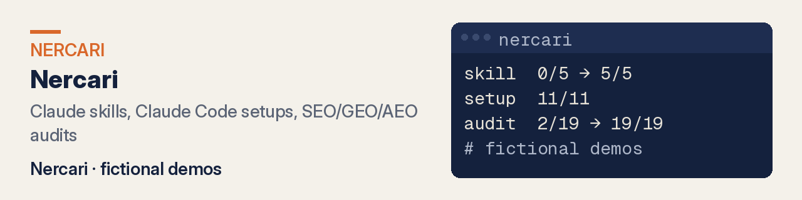
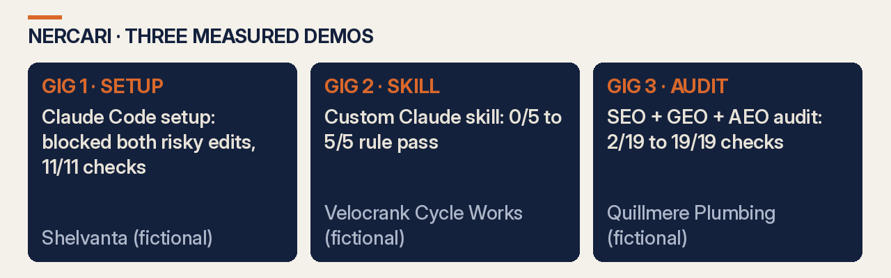

# Nercari

**Claude skills, Claude Code setups and SEO/GEO/AEO audits.** Files delivered, no calls. Every number below can be reproduced from the linked repo.

**[Hire me on Fiverr →](https://www.fiverr.com/nercari)** · **[See live demos](https://nercari.github.io/Nercari/)**

## What you get

| Service | Packages | Showcase | Measured result (2026-10-14) | Live demo | Gig |
|---|---|---|---|---|---|
| Custom Claude skill | ONE SKILL / TESTED SKILL / SKILL PACK | [claude-skill-examples](https://github.com/Nercari/claude-skill-examples) | Rule pass rate on the same 5 inputs: **0/5 → 5/5** (`measurements/score.py`) | [pages](https://nercari.github.io/claude-skill-examples/) | Fiverr gigs coming soon |
| Claude Code setup | RULES FILE / SAFE SETUP / FULL TEAM SETUP | [claude-code-setup-example](https://github.com/Nercari/claude-code-setup-example) | **Left .env and migrations untouched** in the test; setup checks **11/11** (`check.py`) | [pages](https://nercari.github.io/claude-code-setup-example/) | Fiverr gigs coming soon |
| SEO + GEO + AEO audit | AUDIT / AUDIT + FIXES / AUDIT, FIXES + FAQ | [seo-geo-aeo-audit-demo](https://github.com/Nercari/seo-geo-aeo-audit-demo) | Audit **2/19 → 19/19** (`accept.py`); Lighthouse SEO 92→100, A11y 69→96 | [pages](https://nercari.github.io/seo-geo-aeo-audit-demo/) | Fiverr gigs coming soon |

## How it works

1. Pick the gig and package on Fiverr and send your files or repo.
2. The work is delivered as files (or a pull request), with the checks that prove it.
3. Each showcase repo shows the same method on a fictional business, with the commands to re-run it.

## What this is and isn't

- **Sample data, labelled.** Every showcase is a demo on a fictional business, not client work:

  | Demo | Fictional name |
  |---|---|
  | SEO/GEO/AEO | **Quillmere Plumbing** (Marlowe Falls, OR) |
  | Claude Code | **Shelvanta** |
  | Claude skill | **Velocrank Cycle Works** |

  Each name was checked to make sure no real business uses it.
- **Limits.** Demo numbers show the method on sample data. Your results depend on your inputs.
- **No guarantee.** No rankings, traffic or AI citations are promised.
- **Secrets.** No keys or customer data in any repo. Access you grant is scoped to the job and can be revoked after delivery.

## FAQ

### How do I verify a number?
Open the repo README, run the listed command, and compare to the dated table.

## Docs

- [claude-skill-examples](https://github.com/Nercari/claude-skill-examples) · [claude-code-setup-example](https://github.com/Nercari/claude-code-setup-example) · [seo-geo-aeo-audit-demo](https://github.com/Nercari/seo-geo-aeo-audit-demo)
- `llms.txt` — machine-readable summary for AI crawlers
- `docs/pages/` — the GitHub Pages hub

Delivery through Fiverr (Nercari). No calls.
